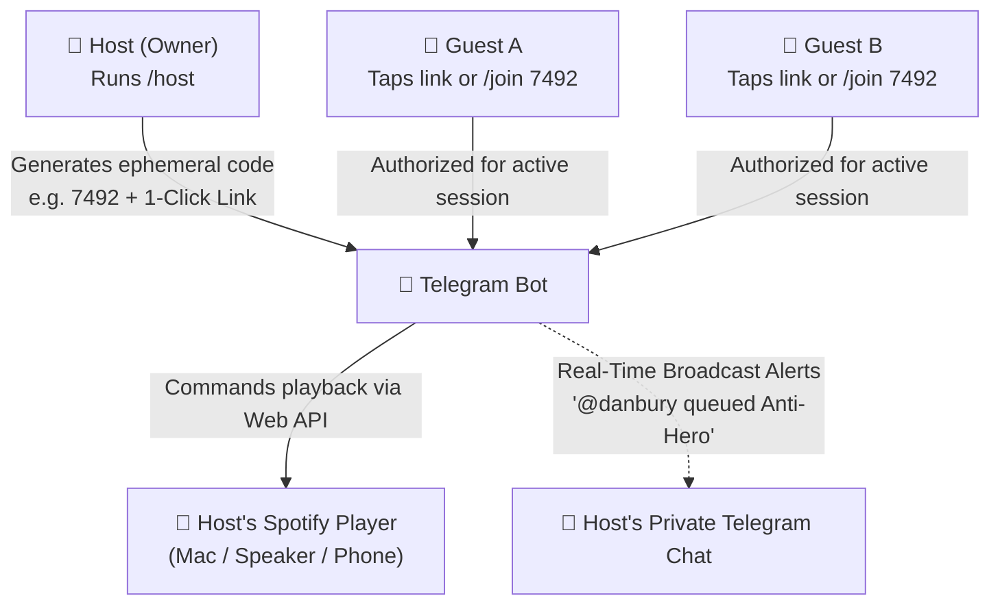

# 🌹 The Baroness — Spotify Telegram Bot (v2)

A revamped Telegram bot that serves as your Regency-style musical arbiter (**"The Baroness"**) and remote control deck for Spotify. Built with `python-telegram-bot`, `spotipy`, and `lyricsgenius`—operating **entirely without AI API keys**.

---

## ✨ Features

### 1. Seven Curation & Discovery Modes (`/select`)
- **A Chart-Topping Number ♭** — Curates a random hit from global/top charts without repeating recently sent tracks (resets every 15 minutes).
- **A Harmonious Find ♯** — Search for any song on Spotify (type directly after selecting, or prefix anytime with `~Song Name`). Includes quick-select buttons for alternative matches.
- **A Melody for Your Spirits ♮** — Pick from 6 interactive parlor mood cards (*Radiant & Euphoric*, *Melancholy & Saudade*, *Romantic & Tender*, *Serene & Tranquil*, *Fierce & Tempestuous*, *Midnight Reverie*) or type your mood with `*mood` to curate tracks matching those audio characteristics.
- **Tracks from a Beloved Maestro ♪** — Search and play tracks from a specific artist (type directly after selecting, or prefix anytime with `!Artist Name`), prioritizing exact artist name matches.
- **Tracks from a Personal Collection 𝄢** — Browse your own Spotify playlists and start playback directly from Telegram.
- **Serendipity's Choice ☾** — Discover a completely random track from Spotify's catalog.
- **In the Spotlight ✧** — View a live Now Playing card with playback status, progress timestamp, active device, volume, shuffle, and repeat state.

---

### 2. Custom Telegram Playback Control Deck (`/controls`)

| Row | Controls | Description |
| :--- | :--- | :--- |
| **Row 1: Transport** | `⏮ Prev` · `⏯ Play / Pause` · `⏭ Next` | Resume or pause active playback without wiping the queue, or skip tracks. |
| **Row 2: Modes & Volume** | `🔀 Shuffle` · `🔁 Repeat` · `🔉 -10%` · `🔊 +10%` | Toggle shuffle on/off, cycle repeat mode (`off` → `context` → `track`), and adjust device volume. |
| **Row 3: Queue & Library** | `>> Queue` · `❥ Save/Unsave` · `+ Playlist` | Add the track to your queue, save/remove from Liked Songs, or add to any of your personal playlists (with duplicate detection). |
| **Row 4: Discovery & Lyrics** | `✿ Similar Tune` · `❀ Maestro's Best` · `𝛂 Lyrics` | Get a similar song recommendation, another top track by the same artist, or fetch formatted lyrics via Genius. |
| **Row 5: Navigation** | `✧ Spotlight` · `📱 Devices` · `📜 Menu` | Refresh the Now Playing card, switch active playback between your phone/desktop/web player, or return to the main menu. |

---

### 3. Immediate Auto-Playback on Recommendation & Discovery
Whenever you choose or request any track (*Serendipity's Choice*, *✿ Similar Tune*, *❀ Maestro's Best*, *A Chart-Topping Number*, *A Melody for Your Spirits*, *A Harmonious Find*, or alternative track selections):
- **Immediate Playback**: The bot immediately commands Spotify to start streaming that exact track on your active player, replacing the active track without requiring extra button presses.
- **Atomic Cloud Sync**: Waits for Spotify's cloud player to acknowledge the change before outputting metadata.
- **Rich Card & Controls**: Presents The Baroness's Regency writeup alongside the live Now Playing card and the full 15-button playback deck.

---

## 🌟 What Makes This App Special & Stand Out

Most music bots are either sterile Discord commands (`!play url`) or paywalled wrappers around bloated LLMs. **The Baroness** delivers a completely unique combination of design, speed, and social convenience:

```
┌──────────────────────────────────────────────────────────────────────────────────────────────────┐
│                                   WHY THE BARONESS STANDS OUT                                    │
├─────────────────────────┬───────────────────────────────────┬────────────────────────────────────┤
│ Feature                 │ Traditional Music Bots            │ The Baroness (v2)                  │
├─────────────────────────┼───────────────────────────────────┼────────────────────────────────────┤
│ Social Party Playback   │ Every guest needs Spotify Premium │ ONLY the host needs Premium        │
│ Guest Onboarding        │ Install app + login + pair room   │ Zero apps: 1-click Telegram join   │
│ AI & Token Cost         │ Sluggish ($20/mo LLM API fees)    │ Zero-AI, 0ms latency, $0 forever   │
│ Persona & Voice         │ Generic robot or silent           │ Lady Whistledown Regency satire    │
│ Player Interface        │ Text-only commands                │ Full 15-button hardware deck in UI │
│ Lyrics Delivery         │ Broken by Cloudflare 403 blocks   │ Multi-tier REST engine (LRCLIB/OVH)│
│ Playback Stability      │ Slices bare URIs & wipes queue    │ Album context + offset preservation│
└─────────────────────────┴───────────────────────────────────┴────────────────────────────────────┘
```

1. **Frictionless Social Playback (Zero Guest Accounts)**:
   - Official Spotify "Group Sessions" require **every single guest to pay for Spotify Premium**, have the Spotify app installed, and be physically nearby.
   - With this bot, **one host** links their account, and **all guests** can search, queue, and control music from Telegram on iOS, Android, Mac, Windows, or Linux without needing a Spotify account or app.
2. **Zero-AI, Zero-Latency, Pure Persona**:
   - Built with high-variety, deterministic Regency prose generators. You get rich, theatrical Bridgerton/Lady Whistledown commentary on every song, mood, and artist with **zero token fees, zero rate limits, and instantaneous response times**.
3. **Hardware-Grade Control Deck Inside Chat**:
   - Transports a full physical remote control into your message thread: transport, volume stepping (±10%), shuffle, 3-state repeat cycling, queue additions, Liked Songs library toggle, playlist picker with duplicate checking, and device switcher.
4. **Resilient Multi-Tiered REST Lyrics Engine**:
   - When Genius blocked HTML web scrapers worldwide with Cloudflare Turnstile 403 errors, this bot engineered an open REST pipeline (LRCLIB + Lyrics.ovh + Genius) that delivers clean, ad-free lyrics in under 300ms.
5. **Context-Preserving Playback Engine**:
   - Rather than blasting bare track URIs that destroy desktop queue buffers, the engine starts playback within album contexts using offsets (`context_uri=target_album, offset={"uri": track_uri}`) to keep playback smooth and continuous.

---

## 🚀 Getting Started

### 1. Prerequisites
- Python 3.10+
- An active **Spotify Premium** account (required by Spotify's Web API for remote playback controls)
- A **Spotify Developer App** ([Spotify Developer Dashboard](https://developer.spotify.com/dashboard)) with Redirect URI set to `http://127.0.0.1:8888/callback`
- A **Telegram Bot Token** from [@BotFather](https://t.me/BotFather)
- *(Optional)* A **Genius API Client Access Token** ([Genius API Clients](https://genius.com/api-clients)) for fetching song lyrics

### 2. Installation

You can reuse the existing virtual environment from `../spotify-telegram-bot` or create a new one:

```bash
cd /Users/gin/Documents/spotify/spotify-telegram-bot-v2

# Option A: Use existing virtual environment
source ../spotify-telegram-bot/bin/activate

# Option B: Create a fresh virtual environment
# python3 -m venv venv
# source venv/bin/activate

pip install -r requirements.txt
```

### 3. Environment Variables (`.env`)

Ensure `.env` in `spotify-telegram-bot-v2/` contains your credentials:

```env
SPOTIPY_CLIENT_ID=your_spotify_client_id
SPOTIPY_CLIENT_SECRET=your_spotify_client_secret
SPOTIPY_REDIRECT_URI=http://127.0.0.1:8888/callback
TELEGRAM_ACCESS_TOKEN=your_telegram_bot_token
GENIUS_ACCESS_TOKEN=your_genius_access_token

# Single-user private mode (your personal Telegram user ID)
ALLOWED_TELEGRAM_USER_IDS=1112011623

# AI API keys are disabled in v2
# OPENAI_API_KEY=
```

### 4. Spotify Authorization (`auth.py`)

Before starting the bot for the first time (or whenever your Spotify session expires), run the authentication helper:

```bash
python auth.py
```

- Your browser will open Spotify's login and authorization page (or open the printed URL).
- Click **Agree** to authorize playback control and library scopes.
- Your browser will redirect to a URL starting with `http://127.0.0.1:8888/callback?code=...` (even if your browser displays *"Unable to connect"*, the URL in the address bar contains your authorization code).
- Copy that full URL from your browser's address bar, paste it into the terminal prompt, and press Enter.
- The script will exchange the code for a fresh Spotify token and save it to `.cache`.

### 5. Run the Bot

```bash
python main.py
```

---

## 🛠 Troubleshooting & Bug Fixes Log

A complete record of issues diagnosed, investigated, and resolved during development:

### 1. Telegram Polling Conflict (`telegram.error.Conflict`)
- **Symptom**: `telegram.error.Conflict: terminated by other getUpdates request; make sure that only one bot instance is running`.
- **Cause**: Telegram Bot API only allows one active polling connection per bot token at any given moment. A background process was running simultaneously with the terminal instance.
- **Fix**: Terminated duplicate background tasks (`manage_task kill`) and ensured only a single bot process polls at a time.

---

### 2. Expired / Revoked Spotify Token (`invalid_grant`)
- **Symptom**: `spotipy.oauth2.SpotifyOauthError: error: invalid_grant, error_description: Refresh token revoked` causing `A chart-topping tune could not be retrieved right now`.
- **Cause**: The `.cache` file copied from the older repository contained an expired/revoked session token from an earlier year. Spotipy crashed when attempting to refresh an invalid grant.
- **Fix**: Removed stale `.cache`, created the [`auth.py`](file:///Users/gin/Documents/spotify/spotify-telegram-bot-v2/auth.py) authentication helper to generate fresh credentials with full playback scopes, and added error trapping with helpful prompts in `main.py`.

---

### 3. Port 8888 Collision & IPv6 Connection Refused
- **Symptom**: `OSError: [Errno 48] Address already in use` or browser displaying *"This site can’t be reached (localhost refused to connect)"*.
- **Cause**: Spotipy's default `open_browser=True` launches an internal `HTTPServer` on port `8888`. If port 8888 was lingering from a previous script, it crashed with `Errno 48`. When browsers attempted to connect via IPv6 `[::1]:8888`, the connection was refused.
- **Fix**: Re-architected [`auth.py`](file:///Users/gin/Documents/spotify/spotify-telegram-bot-v2/auth.py) with `open_browser=False` to eliminate port binding entirely. Instead, the script opens the browser to Spotify's login page and prompts you to copy/paste the redirected address bar URL directly into the terminal, parsing the authorization code cleanly.

---

### 4. Redirect URI Mismatch & Security Whitelist
- **Symptom**: `redirect_uri: Not matching configuration` or `This redirect URI is not secure`.
- **Cause**: Spotify OAuth 2.0 strictly enforces exact string matching against the Redirect URIs configured in the [Spotify Developer Dashboard](https://developer.spotify.com/dashboard). Furthermore, Spotify updated its security policy (per RFC 8252) to disallow plain `http://localhost` over HTTP.
- **Fix**: Standardized on the permitted loopback IP literal `http://127.0.0.1:8888/callback` across `.env`, `README.md`, and the Spotify Developer Dashboard settings.

---

### 5. Spotify API 404 Deprecations (Playlists & Recommendations)
- **Symptom**: Spotipy logging `HTTP Error 404` for playlist items and `https://api.spotify.com/v1/recommendations returned 404`.
- **Cause**:
  1. The legacy Today's Top Hits playlist ID (`37i9dQZF1DXcBWIGoYBM5M`) was retired by Spotify, returning `404: Resource not found`.
  2. In late November 2024, Spotify officially deprecated and disabled the `/v1/recommendations` and audio-features endpoints for standard developer apps.
- **Fix**:
  1. Rewrote `chart_topping_number()` to dynamically search top global playlists (`Top 50 Global`, `Today's Top Hits`, `Billboard Hot 100`) and extract live tracks.
  2. Replaced `sp.recommendations(...)` in `recommender()` and `recommender_from_mood()` with Spotify catalog genre and artist search queries, completely eliminating 404 logs.

---

### 6. Queue Overwriting & Blank Now Playing Cards
- **Symptom**: Clicking Play reset the currently playing song back to 0:00, replaced the playback queue with 30 artist tracks, or showed a blank card (`<b></b> by Album:`).
- **Cause**:
  1. The original `play_song` implementation called `sp.start_playback(uris=..., offset={"position": 0})`, which forcefully discarded the user's active queue and restarted from the beginning.
  2. `format_now_playing_card` relied on global variables that were empty strings `""` when no track had been curated in chat.
  3. `toggle_play_pause` checked `current_song()` after only `0.4s` before Spotify cloud synced (which takes ~`0.8s`), raising an uncaught `ValueError`.
- **Fix**:
  1. Consolidated transport into a non-destructive `⏯ Play / Pause` toggle that calls `sp.start_playback(device_id=dev_id)` without `uris`, resuming your existing track from its exact position without resetting.
  2. Updated `format_now_playing_card` to extract track, artist, album, and duration directly from Spotify's live playback object so it is never blank.
  3. Increased sync polling delay to `0.8s` with graceful fallback handling.

---

### 7. Playback Failing to Start (`Application isn’t running. (-600)`)
- **Symptom**: Clicking Play showed successful API calls, but no music played through speakers.
- **Cause**: Spotify's cloud API reported `"gin's mac"` as a registered device from a previous session, but the Spotify desktop application (`/Applications/Spotify.app`) was completely closed on macOS.
- **Fix**:
  1. Verified that the Spotify desktop application must be open to receive audio output.
  2. Integrated a native macOS AppleScript bridge (`macos_spotify_cmd`) inside `main.py` as an immediate local fallback to command Spotify directly on macOS (`tell application "Spotify" to play...`) alongside cloud Web API calls.

---

### 8. Playback Hijacking & Bot Security (`ALLOWED_TELEGRAM_USER_IDS`)
- **Symptom / Security Inquiry**: *"Can anyone who has access to the bot link use the bot? Will it overlap with mine?"*
- **Risk**: In Telegram, bots with public `@username` handles accept messages from anyone who opens a chat with them. Because the bot server is authenticated to your single personal Spotify account via OAuth, any stranger with the bot handle could send commands to change your songs, adjust volume, or modify your saved playlists.
- **Fix**:
  1. Implemented a strict authorization guard via `ALLOWED_TELEGRAM_USER_IDS` in `.env` (configured with your personal Telegram ID `1112011623`).
  2. Guarded all Telegram entry points (`/start`, `/select`, `/controls`, `/nowplaying`, `/devices`, `/help`), direct text handlers (`~`, `*`, `!`), and inline button clicks (`handle_button_callback`) using `is_user_authorized()`.
  3. Any unauthorized user who messages the bot is rejected with a Bridgerton-themed notice (*"Dearest Gentle Traveler, I am afraid this private musical salon is reserved exclusively for its master..."*) and their commands are dropped before touching Spotify.

---

### 9. Song Metadata Race Condition on Artist Search (`!artist`)
- **Symptom**: *"For the song logs, it's not logging it correctly. When I type `![artist]` and it starts playing a song from them, the message shows the previous song."*
- **Cause**: Spotify's Web API is an asynchronous cloud service. When the bot triggers `sp.start_playback(context_uri=f"spotify:artist:{artist_id}")`, Spotify starts streaming the new artist on your device, but `sp.current_playback()` continues to return the previous track's cached metadata for 0.8s – 1.5s. Querying playback immediately captured the old track before Spotify's cloud synced.
- **Fix**:
  1. Implemented an asynchronous polling helper `wait_for_track_change(prev_track_id=old_id, match_artist_id=artist_id, match_artist_name=artist_name)` with exponential polling (up to 4s, checking every 0.5s).
  2. `play_artist_selection` captures the active track ID (`old_id`) prior to sending the play command.
  3. `wait_for_track_change` rejects any cached response where the track ID is still `old_id` or where the artist does not match the chosen maestro, returning only once Spotify confirms the new track is actively playing.
  4. Applied the same atomic change detector to `⏮ Prev` (`play_previous_song`), `⏭ Next` (`play_next_song`), and personal playlist playback (`PPID:`).

---

### 10. Immediate Auto-Playback & Desktop Queue Wipe Fix
- **Symptom**: *"When I clicked on Serendipity's Choice, it stopped playing the current song and removed all playback. It didn't play the new song."*
- **Cause**:
  1. **Bare Track URIs wiping playback buffer**: On Spotify Desktop and Spotify Connect, invoking `sp.start_playback(uris=["spotify:track:..."])` without album context while shuffle or repeat is active destroys the player's active queue buffer, causing Spotify to clear all playback (`item: None`, `is_playing: False`).
  2. **Unplayable / Region-Locked Searches**: Random query searches (`%a%`) without `market="from_token"` could occasionally return tracks not licensed for streaming in the user's country.
- **Fix**:
  1. Updated [`play_and_display_track`](file:///Users/gin/Documents/spotify/spotify-telegram-bot-v2/main.py#L817-L865) to stream tracks with their album context and track offset: `context_uri=target_album, offset={"uri": track_uri}`. This preserves the player's buffer, starts the target song immediately, and keeps `is_playing: True`.
  2. Updated `serendipitys_choice()` to search with `market="from_token"` and filter only playable items (`is_playable: True`).
  3. Integrated `wait_for_track_change(target_track_id=track_id)` for atomic verification before sending the live Now Playing card and controls deck.

---

### 11. Cloudflare 403 Anti-Bot Gate on Genius Web & Multi-Tiered REST Lyrics Engine
- **Symptom**: *"Unfortunately, lyrics for Blank Space are not available, or it may be an instrumental track. It says this for every song now."*
- **Root Cause**:
  1. **Genius.com Cloudflare 403 Blocking**: The official Genius JSON API (`api.genius.com`) only returns metadata and song search results; it intentionally excludes lyrics text due to publisher licensing agreements. The `lyricsgenius` Python library works by scraping `https://genius.com/*-lyrics` via web requests. Genius recently deployed strict Cloudflare Turnstile anti-bot checks across `genius.com`, returning `403 Forbidden` to all automated web-scraping requests (`requests.exceptions.HTTPError: 403 Client Error: Forbidden`).
  2. **Process Running Old Code in Memory**: Python processes keep code in RAM once started. After code modifications, the bot process must be restarted to load updated handlers.
- **Fix**:
  1. **Architected a Multi-Tiered REST Lyrics Engine (`fetch_best_lyrics`)**:
     - **Tier 1 (LRCLIB REST API — `fetch_lrclib_lyrics`)**: Direct query to `https://lrclib.net/api/get` and `/api/search`. Free, open-source, official REST endpoint designed for audio players with zero scraping, no Cloudflare gates, and sub-second response times (~300ms).
     - **Tier 2 (Lyrics.ovh REST API — `fetch_ovh_lyrics`)**: High-availability secondary REST API (`https://api.lyrics.ovh/v1/{artist}/{title}`).
     - **Tier 3 (Genius API Fallback)**: Official search and scraper fallback if unblocked.
  2. **Decoupled from Genius Token Dependency**: The bot no longer aborts if `GENIUS_ACCESS_TOKEN` is unset or failing; Tier 1 and Tier 2 provide pristine lyrics text completely keyless.
  3. **Paragraph-Safe Chunking & HTML Protection (`chunk_lyrics_for_telegram`)**: Chunks text along paragraph breaks (`\n\n`) to prevent splitting HTML tags, with automatic fallback to plain text if Telegram entity parsing ever encounters special characters.

---

## 💬 Bot Commands & Shortcuts

### Slash Commands
- `/start` — Greeted by The Baroness + opens the main selection menu (or 1-click joins a party via link)
- `/select` — Open The Baroness's musical selection menu
- `/controls` — Summon the custom Spotify Playback Controls deck
- `/nowplaying` — Show the currently playing track and playback status
- `/devices` — View and switch active Spotify playback devices
- `/host` — Convene a party session with an ephemeral 4-digit PIN and 1-click invite link (Host only)
- `/join <code>` — Join an active musical salon party using a 4-digit passcode
- `/party` — View current party status, room code, and connected guests
- `/leave` — Exit the active party gathering voluntarily
- `/endparty` — Conclude the party session and revoke all guest access (Host only)
- `/help` — View all available commands and text shortcuts

### Direct Text Shortcuts
You can type these at any time in the chat (or simply type without a prefix right after clicking the corresponding menu button):
- `~Cruel Summer Taylor Swift` — Search for a specific song
- `*saudade` — Curate a track for your mood
- `!Laufey` — Play music by a specific artist

---

## 📖 Architecture & Function Reference

A concise reference guide to every core function implemented in [`main.py`](file:///Users/gin/Documents/spotify/spotify-telegram-bot-v2/main.py):

### 1. Security & Lifecycle
- `is_user_authorized(user)` — Validates if a Telegram user ID is permitted by checking `ALLOWED_USER_IDS`. If the list is empty, grants open access.
- `clear_list()` — Clears recently sent chart song IDs (`sent_songs_ctn`) to reset the 15-minute anti-repetition memory.
- `start_timer()` — Spawns a daemon `threading.Timer` that fires `clear_list()` every 900 seconds (15 minutes).

### 2. Regency Persona & Response Generators (Zero-AI)
- `generate_intro_response()` — Randomly selects an opening Bridgerton/Lady Whistledown greeting letter for `/start`.
- `generate_preliminary_choice_response(user_choice)` — Returns tailored Regency commentary acknowledging the chosen salon menu option.
- `generate_song_writeup(s_title, s_artist, s_alb)` — Dynamically injects live track title, artist name, and album into rotating Regency commentary templates.
- `generate_song_quote(s_title, s_artist)` — Randomly selects one of 7 Regency musical epigrams displayed inside spoiler tags.
- `generate_mood_response(user_mood)` — Crafts an empathetic Regency reflection validating the user's chosen mood.
- `generate_audio_feature_values(user_mood)` — Maps user mood input to acoustic target values for fallback filtering.
- `generate_artist_response(user_chosen_artist)` — Composes a personalized Regency compliment for the requested maestro.
- `clean_song_title(input_song_name)` — Removes extraneous tags (e.g. `(Live)`, `Remastered`) while preserving hyphenated words.
- `format_song_name(input_song_name)` — Backwards-compatible alias for `clean_song_title`.
- `clean_raw_lyrics(raw_lyrics)` — Cleans raw scraped lyrics by removing Genius headers, embed counters, and redundant whitespace.
- `chunk_lyrics_for_telegram(title, lyrics_body)` — Formats lyrics with Regency headers and chunks text along paragraph breaks to prevent HTML entity truncation.
- `fetch_best_lyrics(title, artist_str)` — Multi-tiered Genius search engine prioritizing targeted exact artist matches, cleaned title variants, and translation-filtered fallbacks.
- `format_ms(ms)` — Converts millisecond durations to standard `M:SS` format.
- `format_now_playing_card(playback, header_note)` — Compiles live playback details (title, artist, album, progress, device, volume, shuffle, repeat, quote) into an HTML card that is never blank.

### 3. Keyboards & Navigation
- `menu_keyboard()` — Builds the 6-button main salon discovery menu.
- `mood_preset_keyboard()` — Builds the 6 interactive parlor mood cards (*Radiant*, *Melancholy*, *Romantic*, *Serene*, *Tempestuous*, *Midnight*).
- `playback_keyboard()` — Builds the custom 15-button Spotify playback control deck (transport, volume, modes, queue, save, lyrics, devices, menu).

### 4. Spotify Track Helpers
- `s_name(path)` — Extracts track name from a Spotify track dictionary.
- `s_id(path)` — Extracts Spotify track ID.
- `s_artist_name(path)` — Formats comma-separated artist names.
- `s_artist_id(path)` — Extracts primary artist ID.
- `s_preview_url(path)` — Extracts 30-second audio preview MP3 URL.
- `s_url(path)` — Extracts the external Spotify web link.
- `s_album(path)` — Extracts the album title.
- `set_global_song_from_track(track_obj)` — Synchronizes global song variables and returns formatted recommendation strings (`rec_1`, `rec_2`).

### 5. Playback & Device Control
- `ensure_device_id()` — Returns the active Spotify player ID, or falls back to the first available connected player.
- `macos_spotify_cmd(action, uri)` — Controls the local macOS Spotify desktop application directly via AppleScript (`osascript`) as an instant fallback.
- `wait_for_track_change(prev_track_id, target_track_id, match_artist_id, match_artist_name)` — Asynchronously polls Spotify until cloud status confirms the track ID has changed or matches the target before rendering status messages.
- `play_and_display_track(...)` — Central auto-playback dispatcher: commands Spotify to stream a new track within its album context (preventing desktop buffer wipe) and renders the live card with the playback controls deck.
- `play_artist_selection(target_message, chosen_artist)` — Initiates playback for an artist catalog context, waits for track confirmation, and displays controls.

### 6. Discovery & Curation Engines
- `chart_topping_number()` — Dynamically searches active global chart playlists (*Top 50 Global*, *Today's Top Hits*, *Viral 50*), filters out recently sent tracks, and selects a trending hit.
- `serendipitys_choice()` — Performs a random wildcard catalog query filtered by `market="from_token"` and `is_playable: True` to select a surprise discovery.
- `harmonious_find(search)` — Searches Spotify for a user-specified track query and caches top alternative results.
- `recommender(artist_id, url)` — Discovers similar tracks based on the active artist's genre and name.
- `recommender_from_artist(a_id, s_id, s_name)` — Retrieves an artist's top tracks and curates another song from their repertoire.
- `recommender_from_mood(mood_key_or_text)` — Curates tracks matching predefined mood profiles or freeform emotion keywords.
- `current_song()` — Fetches live `sp.current_playback()` details and updates global state variables.

### 7. Telegram Bot Commands & Callbacks
- `post_init(application)` — Registers bot commands and sets the Telegram UI menu button at startup.
- `start(update, context)` — `/start` handler: sends greeting letter and opens main salon menu.
- `select(update, context)` — `/select` handler: re-summons the curation menu.
- `controls_command(update, context)` — `/controls` handler: summons the custom playback deck.
- `nowplaying_command(update, context)` — `/nowplaying` handler: inspects the spotlight track and displays its status card.
- `devices_command(update, context)` — `/devices` handler: lists connected Spotify players.
- `help_command(update, context)` — `/help` handler: displays command guide and text shortcut cheat sheet.
- `send_devices_menu(...)` — Renders available Spotify devices with active status badges (`🟢`/`⚪`) and transfer buttons.
- `handle_text_callback(update, context)` — Routes incoming text messages based on prefixes (`~song`, `*mood`, `!artist`) or active conversation mode.
- `handle_button_callback(update, context)` — Central callback query router handling all inline button actions (transport, volume, modes, queue, save, playlists, lyrics, discovery).

---

## 🔍 Deep Dive: Spotify API Search & Retrieval Mechanics

This section details the exact queries, filters, API endpoints, deduplication strategies, and fallbacks used by each curation function to discover and stream music.

```
┌──────────────────────────────────────────────────────────────────────────────────────────────┐
│                                 SPOTIFY API DISCOVERY FLOW                                   │
└──────────────────────────────────────────────────────────────────────────────────────────────┘
  1. A Chart-Topping Number   ──► sp.search(q="Top 50 Global", type="playlist") ─► sp.playlist_items()
  2. Serendipity's Choice     ──► sp.search(q="%<char>%", offset=0..50, market="from_token")
  3. A Harmonious Find        ──► sp.search(q="<query>", type="track", limit=5)
  4. A Melody for Your Spirits──► sp.search(q='genre:"<mood_genre>"', type="track", limit=30)
  5. Beloved Maestro          ──► sp.search(q="<artist>", type="artist") ─► context_uri="spotify:artist:id"
  6. Similar Tune             ──► sp.artist(id) ─► sp.search(q='genre:"<tag>"', type="track")
  7. Maestro's Best           ──► sp.artist_top_tracks(id) ─► Filter out current song
  8. Personal Collection      ──► sp.current_user_playlists(limit=50) ─► Filter owner == user
```

---

### 1. `chart_topping_number()` — "A Chart-Topping Number ♭"
> **In Plain English:** The bot checks Spotify's live global charts (like *Top 50 Global* and *Today's Top Hits*) and instantly plays a popular trending hit you haven't heard yet in this session.

- **Spotify API Endpoints:**
  - `sp.search(q=query, type="playlist", limit=5)`
  - `sp.playlist_items(playlist_id, limit=30)`
  - `sp.current_user_top_tracks(limit=30, time_range="short_term")` *(Fallback 1)*
  - `sp.search(q="hit", limit=30, type="track")` *(Fallback 2)*
- **Search Strategy:**
  - Iterates over dynamic chart query terms: `["Top 50 Global", "Today's Top Hits", "Top Hits 2026", "Viral 50 Global"]`.
  - Retrieves the top matching playlist and extracts up to 30 track items.
  - Builds a pool of at least 15 trending tracks.
- **Filtering & Deduplication:**
  - Tracks previously played songs in memory via `sent_songs_ctn`.
  - Filters `tracks_pool` against `sent_songs_ctn` so you never hear the same song twice in a session.
  - When the entire pool has been exhausted, `sent_songs_ctn.clear()` resets history automatically so music never stops.
- **Immediate Playback:**
  - Hands the chosen track to `play_and_display_track()`, starting playback via `sp.start_playback(context_uri=album_uri, offset={"uri": track_uri})`.

---

### 2. `serendipitys_choice()` — "Serendipity's Choice ☾"
> **In Plain English:** The bot picks a surprise mystery song out of Spotify's 100-million-track library at random, verifies that it's licensed and playable in your region, and plays it immediately.

- **Spotify API Endpoints:**
  - `sp.search(q=random_query, offset=random_offset, limit=10, type="track", market="from_token")`
  - `sp.search(q="a", offset=0, limit=20, type="track", market="from_token")` *(Fallback)*
- **Search Strategy:**
  - Generates wildcard search patterns across the alphabet: `"%a"`, `"%a%"`, `"a%"`, etc.
  - Randomly selects one query string and pairs it with a random offset between 0 and 50: `random.randint(0, 50)`.
- **Licensing & Region Filtering:**
  - Passes `market="from_token"`: guarantees Spotify checks licensing against your actual account region.
  - Inspects results and discards unplayable tracks: `[t for t in items if t and t.get("is_playable", True)]`.
- **Immediate Playback:**
  - Selects a random playable candidate and streams it via `play_and_display_track()`.

---

### 3. `harmonious_find(search)` — "A Harmonious Find ♯" (`~query`)
> **In Plain English:** Type any song name or lyrics (e.g. `~Cruel Summer`), and the bot finds the exact track on Spotify and plays it instantly, while giving you buttons to switch to alternative versions (like acoustic or live cuts).

- **Spotify API Endpoints:**
  - `sp.search(q=query_str, offset=0, limit=5, type="track")`
- **Search Strategy:**
  - Strips any leading `~` prefix and whitespace from user input.
  - Queries Spotify's catalog for top matching tracks (limit 5).
- **Result Caching & Alternative Buttons:**
  - Automatically streams the #1 top match immediately (`items[0]`).
  - Simultaneously stores items 1–4 into `search_track_cache`.
  - Attaches quick-switch interactive buttons (`TRK:1`, `TRK:2`, `TRK:3`) directly to the Telegram message so you can switch to an alternate version with a single tap if the first wasn't your intended mix.

---

### 4. `recommender_from_mood(mood_key_or_text)` — "A Melody for Your Spirits ♮" (`*mood`)
> **In Plain English:** Tap a parlor mood card (like *Radiant*, *Romantic*, or *Melancholy*) or type how you feel (e.g. `*calm`), and the bot finds a song tailored to that emotional vibe and starts playing it.

- **Spotify API Endpoints:**
  - `sp.search(q=query, type="track", limit=30)`
  - `sp.search(q="acoustic pop", type="track", limit=20)` *(Fallback)*
- **Search Strategy:**
  - **Preset Match:** If matching one of the 6 parlor presets (*Radiant*, *Melancholy*, *Romantic*, *Serene*, *Tempestuous*, *Midnight*):
    - Retrieves preset search terms (e.g., `"euphoric dance"`, `"lo-fi chill"`, `"rainy day acoustic"`) and genre tags (e.g., `genre:"indie"`, `genre:"pop"`, `genre:"r-b"`).
    - Selects a random query variant to ensure diversity on every tap.
  - **Freeform Text Match:** If user inputs custom text (e.g., `*heartbreak` or `*studying`):
    - Analyzes keywords using `generate_audio_feature_values()` to map to the closest emotional profile, or queries `f"{mood_key_or_text} music"`.
- **Candidate Pool Sampling:**
  - Fetches 30 candidate tracks matching the mood genre.
  - Selects a track at random via `random.choice(candidates)` and immediately streams it.

---

### 5. `play_artist_selection()` — "Tracks from a Beloved Maestro ♪" (`!artist`)
> **In Plain English:** Type any artist's name (e.g. `!Laufey` or `!The Weeknd`), and the bot finds their official artist discography on Spotify and begins playing their music through your speakers.

- **Spotify API Endpoints:**
  - `sp.search(q=query_val, limit=10, type="artist")`
  - `sp.start_playback(context_uri=f"spotify:artist:{artist_id}")`
  - `sp.artist_top_tracks(artist_id)` *(Fallback if Spotify player is sleeping)*
- **Search Strategy:**
  - Queries Spotify's artist catalog with `limit=10`.
  - **Exact Match Prioritization:** Iterates through results to find an exact case-insensitive match (`a["name"].lower() == query.lower()`). This prevents substring or collaborative collisions (e.g., typing `"milet"` returning `"Aimer"` because of collaborative releases).
- **Immediate Playback:**
  - Launches full artist context playback directly on your Spotify device.
  - Asynchronously polls `wait_for_track_change(match_artist_id=artist_id)` until the player confirms music is streaming from this artist.

---

### 6. `recommender(artist_id, url)` — "✿ Similar Tune"
> **In Plain English:** Tap this while a song is playing to discover a fresh track by a similar artist that shares the same musical style and genre, playing it immediately.

- **Spotify API Endpoints:**
  - `sp.artist(artist_id)`
  - `sp.search(q='genre:"<genre>"', type="track", limit=30)`
  - `recommender_from_artist(artist_id, song_id, song_name)` *(Fallback)*
- **Search Strategy:**
  - Calls `sp.artist(artist_id)` to extract Spotify's official genre taxonomy tags for the artist.
  - Constructs a targeted query: `genre:"<primary_genre>"`. If no genre tag is assigned by Spotify, searches by artist name in quotes: `"<artist_name>"`.
- **Deduplication:**
  - Pulls 30 candidates and explicitly filters out the current track: `t["id"] != song_id`.
  - Randomly selects from candidates and auto-plays via `play_and_display_track()`.

---

### 7. `recommender_from_artist(a_id, s_id, s_name)` — "❀ Maestro's Best"
> **In Plain English:** Tap this to immediately play another one of the greatest hits by the artist you're currently listening to (without repeating the song currently playing).

- **Spotify API Endpoints:**
  - `sp.artist_top_tracks(artist_id)`
- **Search Strategy:**
  - Pulls the top 10 most popular tracks for the specified artist.
- **Deduplication:**
  - Filters out the song currently playing: `candidate["id"] != song_id and candidate["name"] != song_name`.
  - Randomly picks from the remaining top tracks and immediately streams it.

---

### 8. `Tracks from a Personal Collection 𝄢` (`PPID:`)
> **In Plain English:** Shows you an interactive menu of your own personal Spotify playlists so you can tap one and instantly start playing your own collection directly from Telegram.

- **Spotify API Endpoints:**
  - `sp.current_user()`
  - `sp.current_user_playlists(limit=50)`
  - `sp.start_playback(context_uri=f"spotify:playlist:{playlist_id}")`
- **Search Strategy:**
  - Fetches the authenticated user's `display_name`.
  - Queries all library playlists and filters: `playlist["owner"]["display_name"] == current_user_display`. This ensures only playlists *created* by you are shown, excluding public curated or followed playlists.
- **Immediate Playback:**
  - Displays each playlist as an interactive button (`PPID:<id>`).
  - When clicked, immediately streams the playlist via `context_uri=f"spotify:playlist:{playlist_id}"`.


---

## 🔮 Future Work & Roadmap: Multi-User Collaboration & Code Sharing

### 1. How Multi-User Control Works Today
Currently, the bot is linked to your **Spotify Premium account** via OAuth. When access is opened (e.g., leaving `ALLOWED_TELEGRAM_USER_IDS=` blank or listing friend Telegram IDs):
- **On Your Spotify App (Real-time Sync):**
  - **Yes, it will show on your side immediately.** Because the bot commands your Spotify account directly via the Spotify Web API, any change a friend makes (skipping a track, choosing a mood, adjusting volume, pausing) instantly updates the Spotify app on your Mac, iPhone, or connected smart speaker in real-time.
- **On Your Telegram Chat (Interface Separation):**
  - **In 1-on-1 Private Chats:** Telegram private chats are completely isolated. When a friend messages the bot in their private chat, their buttons and cards stay in their own chat window; they do not automatically appear in your Telegram chat. However, you can see what is playing anytime by typing `/nowplaying` or looking at your Spotify app.
  - **In a Telegram Group Chat:** If you add the bot to a shared group chat, **everyone sees all commands, search results, and playback cards together** in real-time.

---

### 2. Live Feature: Party Passcode & Room Code Sharing (`/host` & `/join`)
Instead of having to manually edit `.env` with friends' Telegram numeric IDs and restarting the server whenever guests visit, this dynamic party session architecture is now live:



#### Implemented & Live Capabilities:
1. **Host Commands (`/host`, `/party`, `/endparty`):**
   - `/host` — Generates a temporary 4-digit passcode (e.g., `7492`) and an instant 1-click invite link (`https://t.me/Bot?start=7492`).
   - `/party` — Displays session duration and real-time roster of connected guests.
   - `/endparty` — Concludes the gathering, revokes all guest sessions, notifies guests, and restores private master mode.
2. **Guest Commands (`/join <code>`, `/leave`, or 1-Click Link):**
   - **One-Click Deep Linking:** Guests tap `https://t.me/YourBot?start=7492` to authenticate and join instantly without manual code entry.
   - **Manual Code:** Guests can also message the bot `/join 7492`.
   - `/leave` — Guests can exit the gathering voluntarily at any point.
3. **Live Host Activity Broadcast Feed:**
   - Whenever any guest selects or controls playback (skips, pauses, resumes, changes volume, queues tracks, saves to Liked Songs, or plays playlists/artists), the bot sends an immediate alert to the host's private chat attributing the action to `@username` or guest ID.
   - Actions taken by the host themselves are automatically suppressed from the broadcast feed to avoid redundant chat echoes.

#### Future Enhancements:
- `/kick @username` — Remove an individual guest without ending the whole party.
- **Collaborative Queue Only Mode:** Option to force all guest song selections to `sp.add_to_queue()` to prevent interrupting current playback.
- **Democratic Skip Voting:** Require 50%+ of connected guests to tap `⏭ Next` before skipping.

---

### 3. Scaling to a Multi-Tenant SaaS Platform (Multiple Hosts & Independent Parties)

To transition from a personal party bot to a platform supporting hundreds of simultaneous independent parties:

```
┌─────────────────────────────────────────────────────────────────────────────────────────────────┐
│                               MULTI-TENANT PARTY SCALING FLOW                                   │
└─────────────────────────────────────────────────────────────────────────────────────────────────┘
   Host 1 (Alice)   ──► Web OAuth /login ──► Generates Code "1024" ──► Friends join Alice's Speaker
   Host 2 (Bob)     ──► Web OAuth /login ──► Generates Code "5599" ──► Friends join Bob's Speaker
   Host 3 (Charlie) ──► Web OAuth /login ──► Generates Code "8821" ──► Friends join Charlie's Speaker
                                                    │
                                                    ▼
                     Central SQLite / PostgreSQL Database ("sessions" table)
                     [room_code | host_id | refresh_token | guest_ids | expires_at]
```

1. **Database-Backed Session Storage (Replacing `.cache`)**:
   - Migrate from the local file `.cache` to an encrypted SQLite / PostgreSQL `sessions` table.
   - Key each party session by `room_code` storing the host's encrypted Spotify OAuth refresh token, host Telegram ID, and guest list.
   - Dynamic client instantiation: When any guest sends an instruction, look up their active `room_code` and execute commands via `spotipy.Spotify(auth=session["refresh_token"])`.
2. **Web OAuth Onboarding for Multiple Hosts**:
   - Host runs `/host` in Telegram ➔ bot returns a unique authorization URL: `https://your-domain.com/login?tg_id=<id>`.
   - Host taps the link and authorizes with Spotify in their mobile browser.
   - The web server callback saves the refresh token, generates a 4-digit PIN (e.g., `7492`), and notifies the host in Telegram with their room code and invite link.
3. **Containerized Deployment & Horizontal Scaling**:
   - Package with Docker and deploy on low-cost cloud hosting (Railway, Fly.io, or VPS).
   - Use Redis for sub-millisecond room-code routing and ephemeral guest state caching.

---

## 📜 Changelog & Version History

### [v2.3.1] — November 7, 2026
- **Real-Time Host Activity Broadcasts**:
  - Whenever any guest or listener performs an action involving choosing or controlling a song (skipping tracks, pausing, resuming, adjusting volume, queueing tracks, saving to Liked Songs, toggling shuffle, changing repeat mode, or playing playlists/artists), the bot immediately broadcasts a live activity notification card directly to the host's private Telegram chat.
  - **Self-Echo Suppression**: Actions performed by the host themselves are suppressed from the broadcast feed, preventing redundant notification clutter in the host's personal chat.
  - **Dynamic Actor Attribution**: Clearly highlights the actor's Telegram handle (e.g. `@username`), full name, or guest ID in each notification (e.g. `👑 Salon Activity: @danbury queued Cruel Summer by Taylor Swift`).
  - **Party Mode & Multi-User Whitelist Parity**: Works seamlessly during active Party Mode sessions (`/host`), and falls back to the designated bot owner (`ALLOWED_TELEGRAM_USER_IDS[0]`) in multi-user whitelist deployments.
- **Comprehensive `/help` Compendium Overhaul**:
  - Upgraded the `/help` guide to comprehensively enumerate every single menu command categorized into *Melodic Curation & Playback Deck*, *Salon Party Mode*, and *General & Assistance*, alongside instant direct text shortcuts (`~`, `*`, `!`).

### [v2.3.0] — November 7, 2026
- **Live Party Mode (`/host`, `/join`, `/party`, `/leave`, `/endparty`)**:
  - Implemented dynamic salon room codes allowing the host to run `/host` and generate a temporary 4-digit PIN with a 1-click invite link (`t.me/YourBot?start=7492`).
  - Guests join dynamically without needing Spotify accounts, Spotify apps, or `.env` configuration updates.
  - Added real-time host notifications when guests join or leave.
  - Added `/party` to view connected guests and session duration.
  - Added `/endparty` to immediately conclude the gathering and revoke all guest access.
- **Plain-English Deep Dive Clarifications**:
  - Added simple, non-technical *"In Plain English"* explanations at the top of every discovery engine in the architecture reference.

### [v2.2.0] — November 7, 2026
- **Multi-Tiered REST Lyrics Engine**:
  - Integrated **LRCLIB** (`https://lrclib.net`) as Tier 1 primary lyrics provider: 100% free, open-source REST API built for audio players that bypasses Cloudflare 403 anti-bot gates entirely.
  - Integrated **Lyrics.ovh** as Tier 2 high-availability fallback REST API.
  - Retained Genius as Tier 3 scraper fallback.
  - Decoupled from Genius API key: the bot now delivers lyrics out of the box even without a `GENIUS_ACCESS_TOKEN`.
- **Title Sanitization & Unicode Apostrophe Normalization**:
  - Upgraded `clean_song_title` to preserve legitimate hyphenated titles (*"Can't Feel My Face"*, *"T-Shirt"*, *"Spider-Man"*, *"A-O-K"*) while cleanly stripping edition tags (*"- Taylor's Version"*, *"- Remastered"*, *"- From The Vault"*, *"(feat. ...)"*).
  - Resolved straight (`'`) vs. curly (`’`) apostrophe mismatches across all lyrical search providers.
- **Paragraph-Safe Chunking & HTML Protection**:
  - Implemented `chunk_lyrics_for_telegram` which splits oversized lyrics along paragraph boundaries (`\n\n`) so HTML styling tags are never truncated across chunk limits.
  - Added automatic plain-text fallbacks to guarantee messages are always delivered even if special entity parsing conflicts occur.
- **Instant Lyrics Delivery**:
  - Lyrics now display immediately upon tapping `𝛂 Lyrics` in ~300ms, eliminating the redundant 2-step selection menu.

### [v2.1.0] — November 7, 2026
- **Immediate Auto-Playback on Recommendation**:
  - Unified playback dispatcher (`play_and_display_track`) across all 6 curation/discovery flows (*Serendipity's Choice*, *A Chart-Topping Number*, *A Melody for Your Spirits*, *A Harmonious Find*, *✿ Similar Tune*, and *❀ Maestro's Best*).
  - Replaces the current track immediately upon selection without requiring secondary button presses.
- **Desktop Buffer Wipe Fix**:
  - Changed playback initiation to use album context and track offset (`context_uri=target_album, offset={"uri": track_uri}`), preventing Spotify Desktop from wiping its active queue and pausing.
- **Playability & Region Licensing Filter**:
  - Added `market="from_token"` and `is_playable: True` filters to `serendipitys_choice()`, preventing unplayable region-locked discoveries.
- **Multi-User Access & Visibility Architecture**:
  - Documented open access configuration (`ALLOWED_TELEGRAM_USER_IDS=`) and two-sided visibility mechanics (Spotify real-time audio sync vs. Telegram private chat separation vs. shared group chats).
  - Designed the Party Room Code architecture roadmap (`/host`, `/join CODE`, `/leave`, `/endparty`).
- **Comprehensive API Search Mechanics Reference**:
  - Added deep-dive architectural section explaining exact endpoints, search syntax, wildcards, and deduplication logic for each curation function.

### [v2.0.0] — November 6, 2026
- **Zero-AI Regency Transformation**:
  - Replaced all OpenAI and external LLM dependencies with 100% deterministic, high-variety Bridgerton/Lady Whistledown Regency prose templates.
  - Zero API subscription costs, zero token latency, zero quota limits.
- **Revamped 15-Button Playback Control Deck**:
  - Added dedicated controls for transport (prev/pause/next), modes (shuffle, repeat cycle), volume adjustments (±10%), queue management, Liked Songs toggle, playlist picker with duplicate detection, lyrics, and device switching.
- **Directory Isolation**:
  - Created standalone `spotify-telegram-bot-v2/` workspace, keeping legacy v1 code completely intact.


