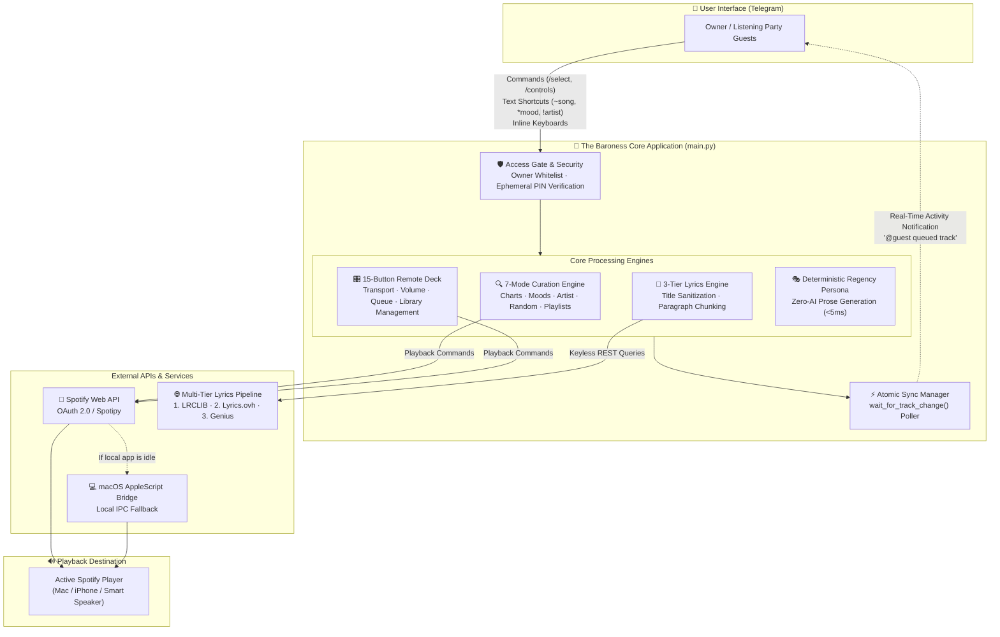

# 🌹 The Baroness — Spotify Curation Concierge & Remote Control Bot (v2)

[](https://www.python.org/)
[](https://core.telegram.org/bots)
[](https://developer.spotify.com/)
[](LICENSE)

> **The Baroness** is a production-grade Telegram bot that functions as a 7-in-1 music curation concierge, a 15-button Spotify remote control deck, and a fast, ad-free lyrics reader. Powered by a deterministic Regency (*Bridgerton* / *Lady Whistledown*) persona, it provides immediate music streaming and social listening without requiring recurring AI token fees ($0/mo).

---

## 📑 Table of Contents

1. [🌟 Executive Overview & Key Advantages](#-executive-overview--key-advantages)
2. [📸 Demo & Visual Showcase](#-demo--visual-showcase)
3. [🏗 System Architecture](#-system-architecture)
4. [✨ Core Capabilities](#-core-capabilities)
   - [7-in-1 Music Curation Engine (`/select`)](#1-7-in-1-music-curation-engine-select)
   - [15-Button Playback Control Deck (`/controls`)](#2-15-button-playback-control-deck-controls)
   - [Collaborative Listening Party Mode (`/host` & `/join`)](#3-collaborative-listening-party-mode-host--join)
5. [💬 Command & Shortcut Reference](#-command--shortcut-reference)
6. [🚀 Quickstart & Setup Guide](#-quickstart--setup-guide)
7. [🔍 Technical Deep Dives](#-technical-deep-dives)
   - [Spotify Search & Curation Mechanics](#1-spotify-search--curation-mechanics)
   - [Resilient 3-Tier Lyrics Pipeline](#2-resilient-3-tier-lyrics-pipeline)
   - [Atomic Synchronization & Queue Preservation](#3-atomic-synchronization--queue-preservation)
   - [Security & Access Guardrails](#4-security--access-guardrails)
8. [🔮 Future Roadmap](#-future-roadmap)
9. [⚖️ Open Source & Acknowledgments](#️-open-source--acknowledgments)

---

## 🌟 Executive Overview & Key Advantages

Traditional music bots are typically restricted to basic text commands (e.g. `!play <url>`) or depend on paid LLM APIs with noticeable latency and high operating overhead. **The Baroness** offers a complete, client-ready alternative:

| Dimension | Standard Music Bots | The Baroness (v2) |
| :--- | :--- | :--- |
| **User Interface** | Text-based prompt interaction | Full 15-button inline hardware remote deck inside Telegram |
| **Discovery** | Manual track search only | 7 curated modes (Mood presets, Charts, Artist, Serendipity, Personal Library) |
| **Lyrics Delivery** | Broken by web scrapers / Cloudflare 403 gates | Keyless 3-Tier REST pipeline (LRCLIB $\to$ Lyrics.ovh $\to$ Genius) in ~300ms |
| **Persona & Operating Cost** | Generic responses or $20+/mo LLM bills | **100% deterministic Regency persona** ($0/mo operating cost, sub-5ms responses) |
| **Playback Continuity** | Clears queue on single-track playback | Context-preserving playback (`context_uri` + track offset) |
| **Social / Guest Access** | Requires all participants to have Spotify Premium | **1-Click Party Mode (`/host`)**: guests join with a PIN and queue songs from Telegram |

---

## 📸 Demo & Visual Showcase

### Live Interaction Walkthrough
> *The Baroness welcoming the listener, initiating instant playback from the global charts to Spotify Desktop, launching the 15-button remote deck, and rendering synced lyrics:*

<p align="center">
  
</p>

### Interface Progression

| 1. Welcome & Main Menu (`/start`) | 2. Remote Control Deck (`/controls`) | 3. Instant Lyrics View (`𝛂 Lyrics`) |
| :---: | :---: | :---: |
|  |  |  |
| *Regency greeting with access to all curation modes and playback decks.* | *Live track status with 15 transport, volume, and library management buttons.* | *Clean, paragraph-formatted lyrics delivered in ~300ms without ad interruptions.* |

| 4. Personal Playlists Collection | 5. Artist Discography & Direct Shortcut (`!ive`) |
| :---: | :---: |
|  |  |
| *Dynamic retrieval of user's personal Spotify playlists with 1-tap playback.* | *Direct artist discovery (`!artist`) with commentary and album portrait.* |

---

## 🏗 System Architecture

The following diagram illustrates the complete end-to-end request lifecycle—from user interaction in Telegram to Spotify device playback and lyrics retrieval:



---

## ✨ Core Capabilities

### 1. 7-in-1 Music Curation Engine (`/select`)
- **A Chart-Topping Number ♭** — Pulls live hits from global playlists (*Top 50 Global*, *Today's Top Hits*) with a 15-minute anti-repetition memory buffer.
- **A Harmonious Find ♯ (`~song`)** — Searches Spotify's global catalog, streams the top match immediately, and attaches inline buttons for alternative mixes (live, acoustic).
- **A Melody for Your Spirits ♮ (`*mood`)** — Maps 6 interactive mood cards (*Radiant*, *Melancholy*, *Romantic*, *Serene*, *Tempestuous*, *Midnight*) or custom keywords to acoustic genre parameters.
- **Tracks from a Beloved Maestro ♪ (`!artist`)** — Searches and streams artist catalogs with exact-name matching to avoid collaboration misattributions.
- **Tracks from a Personal Collection 𝄢** — Dynamically fetches user-created playlists and renders them as 1-tap playback buttons.
- **Serendipity's Choice ☾** — Randomly explores Spotify's 100M+ track catalog with `market="from_token"` validation to guarantee playable results.
- **In the Spotlight ✧** — Generates a live status card with progress timestamps, active device, volume, and shuffle/repeat indicators.

### 2. 15-Button Playback Control Deck (`/controls`)

```
┌─────────────────────────────────────────────────────────────────────────┐
│                      15-BUTTON PLAYBACK CONTROL DECK                    │
├─────────────────┬───────────────────────────────────────────────────────┤
│ Transport       │ ⏮ Prev  ·  ⏯ Play/Pause  ·  ⏭ Next                  │
│ Volume & Modes  │ 🔀 Shuffle  ·  🔁 Repeat Cycle  ·  🔉 -10%  ·  🔊 +10%  │
│ Library & Queue │ >> Add to Queue  ·  ❥ Liked Songs  ·  + Add Playlist   │
│ Discovery       │ ✿ Similar Tune  ·  ❀ Maestro's Best  ·  𝛂 Fast Lyrics   │
│ Device & System │ ✧ Spotlight  ·  📱 Switch Devices  ·  📜 Main Menu     │
└─────────────────┴───────────────────────────────────────────────────────┘
```

### 3. Collaborative Listening Party Mode (`/host` & `/join`)
- **Ephemeral 4-Digit Passcodes**: The host runs `/host` to create a temporary room PIN with a 1-click Telegram deep link (`t.me/YourBot?start=CODE`).
- **No Guest Premium Required**: Guests control and queue music on the host's sound system directly from Telegram without needing Spotify accounts or apps.
- **Live Host Activity Broadcasts**: Actions taken by guests (skipping, queueing, volume changes) are reported to the host's private chat with full user attribution (e.g., `👑 Salon Activity: @danbury queued Cruel Summer by Taylor Swift`).
- **Self-Echo Suppression**: Prevents redundant notification spam when the host performs actions themselves.
- **Session Lifecycle**: The host can view active guests (`/party`) or close the gathering instantly (`/endparty`).

---

## 💬 Command & Shortcut Reference

### Slash Commands
| Command | Scope | Description |
| :--- | :--- | :--- |
| `/select` | All | Launch the 7-mode music curation and discovery menu |
| `/controls` | All | Open the 15-button playback and library remote deck |
| `/nowplaying` | All | Display the active track card, device name, volume, and progress |
| `/devices` | All | Inspect and transfer playback across active Spotify devices |
| `/host` | Host | Convene an ephemeral Listening Party session with a PIN & invite link |
| `/join <code>` | Guest | Join an ongoing gathering via 4-digit code |
| `/party` | All | View current party room code, duration, and connected guests |
| `/leave` | Guest | Disconnect from the party session |
| `/endparty` | Host | Terminate the active party session and revoke guest access |
| `/help` | All | Display the comprehensive guide and text shortcuts |

### Direct Text Shortcuts
Users can send these directly in Telegram without opening menus:
- `~Cruel Summer` $\to$ Search and immediately stream a track
- `*saudade` or `*euphoric` $\to$ Curate music matching an emotional state
- `!Laufey` $\to$ Play discography from a specific artist

---

## 🚀 Quickstart & Setup Guide

### 1. Prerequisites
- Python 3.10+
- An active **Spotify Premium** account (required by Spotify Web API for playback control)
- A registered **Spotify Developer App** ([Dashboard](https://developer.spotify.com/dashboard)) with Redirect URI:
  `http://127.0.0.1:8888/callback`
- A **Telegram Bot Token** from [@BotFather](https://t.me/BotFather)

### 2. Installation
```bash
git clone https://github.com/ginnnn-e/spotify.git
cd spotify/spotify-telegram-bot-v2

# Create and activate virtual environment
python3 -m venv venv
source venv/bin/activate

# Install required dependencies
pip install -r requirements.txt
```

### 3. Environment Configuration
Copy `.env.example` to `.env`:
```bash
cp .env.example .env
```
Populate `.env` with your credentials:
```env
SPOTIPY_CLIENT_ID=your_spotify_client_id
SPOTIPY_CLIENT_SECRET=your_spotify_client_secret
SPOTIPY_REDIRECT_URI=http://127.0.0.1:8888/callback
TELEGRAM_ACCESS_TOKEN=your_telegram_bot_token

# Your personal Telegram User ID (keeps the bot private in solo mode)
ALLOWED_TELEGRAM_USER_IDS=123456789

# Optional: Genius token (Tier 1 & Tier 2 lyrics work without keys)
GENIUS_ACCESS_TOKEN=
```

### 4. Authorize & Launch
```bash
# 1. Complete one-time OAuth authentication
python auth.py

# 2. Run the bot
python main.py
```

---

## 🔍 Technical Deep Dives

### 1. Spotify Search & Curation Mechanics
- **Dynamic Chart Sampling:** Queries top global playlists (`Top 50 Global`, `Today's Top Hits`) and applies an in-memory cache to prevent replaying songs within 15 minutes.
- **Wildcard Search Heuristics:** `serendipitys_choice()` utilizes wildcard character patterns (`%a%`) paired with random offsets (0–50) and `market="from_token"` licensing filters to extract serendipitous, playable discoveries.
- **Exact Artist Disambiguation:** Prioritizes exact case-insensitive matches (`a["name"].lower() == query.lower()`) to eliminate collaboration misattributions.

### 2. Resilient 3-Tier Lyrics Pipeline
When Genius instituted Cloudflare Turnstile anti-bot checks (resulting in HTTP 403 errors on scraped web requests), the bot was refactored with an open, multi-tiered REST architecture:
1. **Tier 1 (LRCLIB API):** Direct REST queries to `https://lrclib.net/api` — keyless, fast (~300ms), and unaffected by Cloudflare challenges.
2. **Tier 2 (Lyrics.ovh API):** Secondary REST fallback endpoint (`api.lyrics.ovh/v1`).
3. **Tier 3 (Genius API):** Tertiary fallback.
4. **Sanitization & Chunking:** Regex filters strip unnecessary metadata (`- Remastered`, `- Taylor's Version`) while preserving valid hyphenated terms (`T-Shirt`). Lyrics exceeding Telegram's 4096-character limit are split along paragraph breaks (`\n\n`) to prevent truncated HTML styling tags.

### 3. Atomic Synchronization & Queue Preservation
- **Queue Preservation:** Rather than dispatching isolated track URIs (`sp.start_playback(uris=[...])`), which erases the player's upcoming queue on desktop clients, playback is initialized with album context and track offsets (`context_uri=album, offset={"uri": track_uri}`).
- **Atomic Polling (`wait_for_track_change`):** Mitigates Spotify API latency (which caches old track state for 0.8s–1.5s) by polling the playback endpoint with exponential backoff until the new track ID is confirmed before rendering updated cards in Telegram.
- **Local macOS Fallback:** Includes an AppleScript (`osascript`) IPC bridge to wake and command the macOS Spotify desktop application directly if background cloud endpoints report the device as inactive.

### 4. Security & Access Guardrails
- **Whitelist Enforcement:** Protected by `ALLOWED_TELEGRAM_USER_IDS`. Unauthorized users who message the public bot handle are rejected before requests interact with Spotify.
- **Credential Protection:** Guests in a `/host` party interact strictly through Telegram inline keyboards; they never receive OAuth tokens or access to the host's credentials.

---

## 🔮 Future Roadmap

- **Collaborative Jukebox Mode:** Restrict guest actions strictly to `sp.add_to_queue()` to prevent premature track interruptions.
- **Democratic Skip Voting:** Require $\ge 50\%$ guest approval before executing `⏭ Next`.
- **Multi-Tenant Database Backend:** Transition from single-host `.cache` files to an encrypted PostgreSQL session table, enabling multiple independent hosts to run party sessions simultaneously from a single bot deployment.

---

## ⚖️ Open Source & Acknowledgments

- [python-telegram-bot](https://github.com/python-telegram-bot/python-telegram-bot) — Asynchronous Telegram Bot API wrapper
- [Spotipy](https://github.com/spotipy-dev/spotipy) — Python client for the Spotify Web API
- [LRCLIB](https://lrclib.net/) — Open community lyrics database
- [Full Version Changelog](CHANGELOG.md) — Comprehensive technical release history
