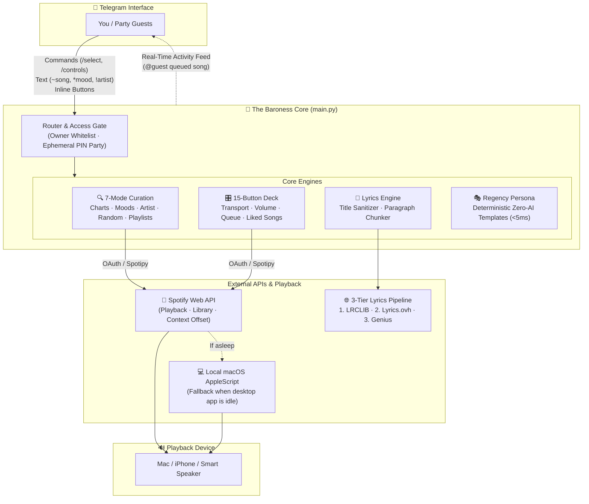

# 🌹 The Baroness — Spotify Telegram Bot (v2)

[](https://www.python.org/)
[](https://core.telegram.org/bots)
[](https://developer.spotify.com/)
[](LICENSE)

> A theatrical, zero-AI Spotify concierge, 15-button remote deck, instant lyrics reader, and optional collaborative listening party room inside Telegram.

---

## ⚡ Quick Demo & Visual Tour

### Live Walkthrough
<p align="center">
  
</p>

### Key Interfaces
| 1. Regency Welcome (`/start`) | 2. Remote Deck (`/controls`) | 3. Fast Lyrics (`𝛂 Lyrics`) |
| :---: | :---: | :---: |
|  |  |  |

| 4. Personal Playlists | 5. Artist Discography (`!artist`) |
| :---: | :---: |
|  |  |

---

## 💡 Why The Baroness?

| Feature | Typical Music Bots | The Baroness (v2) |
| :--- | :--- | :--- |
| **Interface** | Plain text commands (`!play url`) | Interactive 15-button remote deck in Telegram |
| **Discovery** | Manual search only | 7 curated modes (Mood cards, Charts, Serendipity, Maestro, Playlists) |
| **Lyrics** | Unreliable / Cloudflare 403 blocked | Resilient 3-Tier REST pipeline (LRCLIB $\to$ Lyrics.ovh $\to$ Genius) in ~300ms |
| **Cost & Latency**| $20+/mo LLM APIs or generic text | **100% deterministic Regency persona** ($0/mo, <5ms latency) |
| **Social / Party**| Requires everyone to have Spotify Premium | **1-Click Party Mode (`/host`)**: guests join with a PIN and queue songs from Telegram |

---

## 🏗 System Architecture



---

## 🎮 How to Use

### 1. Slash Commands
- `/select` — Open the 7-mode curation menu
- `/controls` — Summon the 15-button remote deck (Play/Pause, Skip, Vol $\pm$10%, Liked Songs, Queue, Devices)
- `/nowplaying` — Show current track card with progress bar and device info
- `/devices` — Switch playback between active Spotify devices (Phone, Mac, Speaker)
- `/host` — Start a Listening Party with a 4-digit PIN and 1-click invite link
- `/party` & `/endparty` — Manage or end the guest session
- `/help` — Full list of commands and tips

### 2. Direct Chat Shortcuts
Type these directly in Telegram at any time:
- `~Cruel Summer` — Search and immediately play a song
- `*saudade` or `*euphoric` — Play music matching a mood keyword
- `!Laufey` — Stream standout music by an artist

---

## 🚀 Getting Started

### 1. Prerequisites
- Python 3.10+
- Spotify Premium account (required by Spotify API for remote control)
- Spotify Developer Application ([Dashboard](https://developer.spotify.com/dashboard)) with Redirect URI set to:
  `http://127.0.0.1:8888/callback`
- Telegram Bot Token from [@BotFather](https://t.me/BotFather)

### 2. Setup & Installation
```bash
# Clone the repository
git clone https://github.com/ginnnn-e/spotify.git
cd spotify/spotify-telegram-bot-v2

# Create and activate virtual environment
python3 -m venv venv
source venv/bin/activate

# Install dependencies
pip install -r requirements.txt
```

### 3. Environment Variables
Copy `.env.example` to `.env`:
```bash
cp .env.example .env
```
Fill in your credentials:
```env
SPOTIPY_CLIENT_ID=your_spotify_client_id
SPOTIPY_CLIENT_SECRET=your_spotify_client_secret
SPOTIPY_REDIRECT_URI=http://127.0.0.1:8888/callback
TELEGRAM_ACCESS_TOKEN=your_telegram_bot_token

# Your personal numeric Telegram User ID (keeps the bot private to you)
ALLOWED_TELEGRAM_USER_IDS=123456789

# Optional: Genius token (Tier 1 & Tier 2 lyrics work without any keys)
GENIUS_ACCESS_TOKEN=
```

### 4. Authorize & Run
```bash
# Authenticate once with Spotify
python auth.py

# Start the bot
python main.py
```

---

## 🛠 Engineering Highlights & Solved Challenges

<details>
<summary><b>1. Resilient 3-Tier Lyrics Engine (Cloudflare 403 Bypass)</b></summary>

- **Problem:** Genius recently deployed Cloudflare Turnstile anti-bot checks, returning `403 Forbidden` to standard web scrapers.
- **Solution:** Built a 3-tier REST failover pipeline:
  1. **LRCLIB (`lrclib.net`)**: High-speed, keyless REST API built specifically for audio players (~300ms).
  2. **Lyrics.ovh**: Lightweight secondary REST fallback.
  3. **Genius API / Scraper**: Tertiary fallback.
- Added automated title sanitization (stripping `Remastered`, `Taylor's Version`, edition tags) and HTML-safe paragraph chunking for Telegram's message limit.
</details>

<details>
<summary><b>2. Queue Preservation & Atomic Playback Sync</b></summary>

- **Problem:** Calling `sp.start_playback(uris=[...])` erased Spotify's active queue buffer on desktop, stopping continuous playback. Furthermore, Spotify's API returned cached old-track metadata for 0.8s–1.5s after a track change.
- **Solution:** 
  - Initiates playback within the album context using track offsets (`context_uri=album, offset={"uri": track}`), keeping continuous queue buffering intact.
  - Added `wait_for_track_change()` with exponential polling to ensure the Telegram card only renders once Spotify confirms the new song is playing.
</details>

<details>
<summary><b>3. Secure Listening Party Mode & Host Broadcast Feed</b></summary>

- **Problem:** Allowing guests to queue songs previously required sharing credentials or manually editing whitelist files.
- **Solution:**
  - Designed an ephemeral room code system (`/host` $\to$ 4-digit PIN + deep link `t.me/Bot?start=CODE`).
  - Guests interact through their own Telegram chats without ever seeing the host's Spotify token.
  - Real-time **Host Activity Feed** notifies the host whenever a guest skips, queues, or adjusts volume, with self-echo suppression so the host is never spammed by their own actions.
</details>

<details>
<summary><b>4. Zero-Cost, Low-Latency Regency Persona</b></summary>

- **Problem:** LLM APIs introduce recurring monthly costs ($10–30/mo) and multi-second generation latencies.
- **Solution:** Replaced external AI models with high-variety, deterministic Regency prose templates and acoustic feature heuristics. Generates customized Bridgerton-style commentary in <5ms at $0 cost.
</details>

---

## ⚖️ Open Source & Acknowledgments
- [python-telegram-bot](https://github.com/python-telegram-bot/python-telegram-bot) — Modern async Telegram bot framework
- [Spotipy](https://github.com/spotipy-dev/spotipy) — Lightweight Python library for the Spotify Web API
- [LRCLIB](https://lrclib.net/) — Open-source lyrics database
